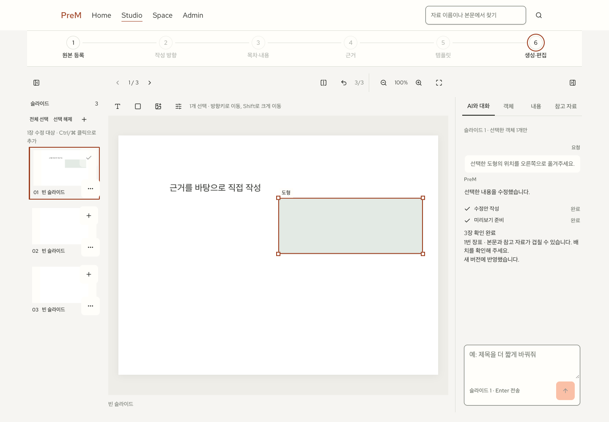

# PreM — Presentation Manager

PreM은 팀의 업무 문서를 **근거를 확인할 수 있는 PowerPoint 발표자료**로 만드는 웹 앱입니다. PDF·HWP·Office 문서에서 본문과 그림을 추출하고, 발표 목차별로 사용할 내용을 골라 회사 템플릿에 배치합니다. 완성된 장표는 웹에서 수정하거나 편집 가능한 `.pptx`로 내려받을 수 있습니다.



## 주요 기능

| 기능             | 할 수 있는 일                                                                                                                                                                           |
| ---------------- | --------------------------------------------------------------------------------------------------------------------------------------------------------------------------------------- |
| 문서 분석        | PDF, HWP/HWPX, DOCX, PPTX, XLSX, HTML, Markdown을 등록합니다. 한국어 OCR과 원본 페이지 미리보기를 지원하며, 원문에 있는 대목차·중목차와 페이지 소속을 확인할 수 있습니다.               |
| 근거·템플릿 관리 | **Space**에 팀이 함께 쓸 레퍼런스와 PPTX 템플릿을 등록합니다. 자료 이름이나 본문으로 검색하고, 출처를 확인한 뒤 글·그림·차트·슬라이드를 재사용합니다.                                   |
| 발표자료 작성    | **Studio**에서 발표 목차를 직접 작성하거나 AI로 구성합니다. 목차별 원문과 근거를 검토한 뒤 템플릿을 선택해 PPTX를 생성합니다. 모델 없이 템플릿의 빈 장표에서 직접 시작할 수도 있습니다. |
| 장표 편집        | 캔버스에서 텍스트·도형·이미지를 추가하고 위치와 크기를 조절합니다. AI에 선택한 객체나 여러 장표의 수정을 요청하고, 전후 미리보기를 비교해 새 버전에 적용합니다.                         |

## 설치와 실행

지원 환경은 **Apple Silicon macOS**와 **Linux AMD64·ARM64**입니다. Git, Bash, tar, C/C++ 빌드 도구, rustup, Node.js와 npm, uv를 준비하세요. WSL에서는 Linux 터미널에서 `uv --version`을 확인하세요. 이 프로젝트는 CPython 3.13.18 설치에 uv 0.13.6을 사용합니다. 프로젝트에서 사용하는 버전은 [Rust 설정](rust-toolchain.toml), [Node 설정](.node-version), [pnpm 설정](package.json), [런타임 설정](scripts/runtime/versions.json)에 있습니다.

```sh
git clone https://github.com/keonho-kim/PreM.git
cd PreM
npm install --global pnpm@12.16.1
```

**앱만 실행할 때**는 `pnpm install --frozen-lockfile`을 실행하세요. **개발·테스트까지 준비할 때**는 이 명령 대신 아래 스크립트를 실행하세요. [setup.sh](scripts/setup.sh)는 pnpm 의존성을 설치하고 Rust 의존성을 받아 둔 뒤, 테스트·커버리지·의존성 검사 도구를 설치합니다.

```sh
./scripts/setup.sh
```

어느 쪽이든 최초 1회 문서 처리 도구와 OCR 모델을 설치한 뒤 서버를 시작합니다. 이미 `setup.sh`를 마쳤다면 여기서 이어가세요.

```sh
pnpm runtime:install
pnpm dev
```

브라우저에서 **[http://127.0.0.1:5173/home/](http://127.0.0.1:5173/home/)**를 엽니다. `pnpm dev`는 Vite와 Rust 서버를 함께 시작하며, `Ctrl+C`로 종료합니다. 최초 런타임 설치에는 인터넷 연결이 필요합니다. 설치 후 문서 추출·OCR·PPTX 렌더링은 로컬에서 실행되고, AI 요청은 Admin에서 지정한 모델 서버로 전송됩니다.

**빌드한 서버로 실행하기.** 개발 서버를 종료한 뒤 저장소 루트에서 실행합니다. 웹 UI는 실행 파일에 포함되고 문서 처리에는 앞에서 설치한 `runtime/`을 사용합니다.

```sh
pnpm build
./target/release/PreM --data-storage-path "$PWD/data" --listen-address 127.0.0.1 --port 8000
```

빌드한 앱의 주소는 **[http://127.0.0.1:8000/home/](http://127.0.0.1:8000/home/)**입니다. 다른 포트를 쓰려면 `--port` 값을 바꾸세요. 같은 데이터 폴더는 한 서버에서만 열 수 있습니다.

## 첫 발표자료 만들기

1. **모델 연결** — 시작 터미널에 출력된 `PreM Admin token`으로 **Admin**에 들어갑니다. **LLM 연결**에서 작성용 모델을 저장하고, **Decision Model 연결**에서 문서 처리·자료 찾기에 쓸 공통 판정 연결을 선택합니다. 전용 Decision 모델 또는 구조화 출력을 지원하는 LLM을 사용할 수 있습니다. Home은 미설정 모델이 있으면 해당 Admin 화면으로 안내합니다. 두 연결 화면의 **연결 진단** 버튼으로 저장한 모델의 실제 응답을 확인하세요.
2. **원본 등록** — **Home**에서 프로젝트를 만든 뒤 **Studio**에 원본을 올립니다. 처리가 끝나면 페이지와 추출 내용을 확인합니다. 여러 프로젝트가 같이 쓸 참고자료와 템플릿은 **Space**에 등록합니다.
3. **목차와 근거 검토** — 작성 방향을 입력하고 발표 목차를 구성합니다. 각 항목에 연결된 원문을 읽고 필요한 근거를 확정합니다. 여기서 발표 목차를 바꿔도 원본 문서의 목차는 그대로 보존됩니다.
4. **생성·편집** — 템플릿과 생성할 항목을 선택해 장표를 만듭니다. 미리보기에서 직접 편집하거나 AI 수정안을 검토한 뒤 **PPTX 다운로드**를 누릅니다.

모델 연결을 저장하려면 사용할 모델을 선택하고 **저장 전 연결 진단**을 실행하세요. **추가 연결 설정**에서 작성용 모델의 Thinking과 effort를 선택할 수 있습니다. 비워 두면 모델 기본값을 사용합니다. Thinking을 켜면 서버에 시험 요청을 보내 수락한 값을 표시합니다. 판정에 사용하는 LLM에는 Thinking 끄기를 요청합니다.

문서가 설정 대기 상태라면 **Admin → Decision Model 연결**에서 공통 판정 연결이 선택돼 있는지 확인하세요. LM Studio에서는 모델별 컨텍스트 길이와 물리 배치 크기를 조절할 수 있습니다. 로딩 값을 변경했다면 저장한 뒤 **저장한 토큰 설정으로 모델 준비**를 누릅니다.

## 데이터와 접근 범위

프로젝트와 Space 자료는 같은 서버에 접속한 사람이 함께 사용합니다. 일반 화면에는 사용자별 로그인이 없고, Admin 토큰은 서버를 재시작할 때 새로 발급됩니다. 팀에서 공유할 때는 네트워크 접근 범위를 배포 환경에서 설정하세요.

원본·생성 파일, SQLite DB, 모델 인증 정보의 암호화 키는 지정한 저장 폴더에 보관합니다. 서버를 종료한 상태에서 DB·파일·키를 함께 백업하고 새 경로에 복원하는 절차는 [백업과 복원](dev-docs/06-development-operations.md#오프라인-백업과-복원)에 있습니다.

## 개발과 문서

백엔드는 Rust·Axum·SQLite, 프론트엔드는 React·TypeScript·Vite를 사용합니다. [Kordoc 기반 문서 런타임](runtime/README.md)이 문서 추출과 OCR을, PPT Master와 네이티브 PPTX 어댑터가 장표 생성을 담당합니다.

| 명령                           | 용도                                                                                       |
| ------------------------------ | ------------------------------------------------------------------------------------------ |
| `pnpm dev sandbox`             | 개발 데이터를 `data/sandbox/`에 분리해 실행                                                |
| `pnpm typecheck` / `pnpm lint` | 타입과 코드 검사                                                                           |
| `pnpm check:core`              | 런타임, Rust·React 테스트, 포맷, 의존성 감사 등 전체 개발 품질 검사                        |
| `pnpm test:e2e`                | 빌드한 서버와 브라우저로 실제 사용자 흐름 검사. [브라우저 도구 준비](tests/README.md) 참고 |

- [사용자 기능과 작업 흐름](dev-docs/02-product-workflows.md) · [슬라이드 편집기](dev-docs/03-editor.md)
- [실행 옵션과 문제 해결](dev-docs/06-development-operations.md) · [검증 범위와 알려진 한계](dev-docs/07-quality-readiness.md)
- [코드 구조](dev-docs/01-architecture.md) · [데이터와 API](dev-docs/04-data-api.md) · [개발 문서 전체](dev-docs/README.md)

## 라이선스

PreM 자체의 공개 라이선스는 아직 지정되지 않았습니다. 포함된 도구·모델·폰트의 고지는 [제3자 라이선스](licenses/README.md)와 [프론트엔드 고지](frontend/THIRD_PARTY_NOTICES.md)에서 확인할 수 있습니다.
