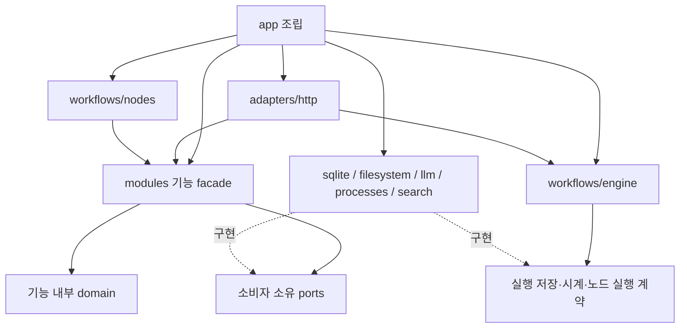

# 본개발 소스 아키텍처

PreM의 제품 구현에 적용할 모듈 책임, 의존 방향, 데이터 변경 경계와 단계별 수용 조건을 정의한다. [문서 색인](README.md)

**이 문서의 소스 트리는 목표 구조다.** 현재 실행 코드의 위치는 [구현 아키텍처](../dev-docs/01-architecture.md), 설치된 패키지·기능과 도입 후보는 [의존성 명세](../dev-docs/08-dependencies.md)를 기준으로 한다. 현재 프로젝트·Space 원본 관리·Admin Provider 연결 기능은 app/modules/adapters 경계에서 실제 DB·API·React 화면으로 구현되어 있다. 나머지 목표 모듈은 미구현이며, 의존성 설치만으로 기능 완료를 판단하지 않는다.

## 1. 배포·실행 구조

Rust 제품 패키지 하나, HTTP·Scheduler 프로세스 하나, SQLite 하나, 회사 제공 Pod 하나를 유지한다. React 정적 결과를 Rust에 포함하고 Office·OCR·PPT 도구와 모델은 릴리스 자산으로 제공한다. 네이티브 문서 처리와 CPU 집약 작업은 제한된 자식 프로세스에서 수행한다.

```text
Browser: React / TypeScript
  └─ Axum HTTP adapter: /home, /api/v1, SSE, health/readiness
       ├─ 짧은 command/query → feature facade → port → adapter
       └─ 장기 command → 영속 Workflow 등록 → Scheduler
                                      └─ Node → feature facade → adapter
Adapters: SQLite / Filesystem / HTTP Provider / Process / Search
Composition root: app (설정, 조립, 시작, 취소, 종료)
```

가이드 저장·목록 조회 같은 짧은 작업을 Workflow로 감싸지 않는다. 외부 호출·변환·생성은 HTTP 요청과 분리하여 상태를 영속화한다. readiness는 실제 필수 자원 상태를 반영하며 단순 프로세스 생존 확인과 구분한다.

## 2. 의존 방향



- domain은 Axum·rusqlite·reqwest·DOM·Provider 메시지를 참조하지 않는다.
- command/query는 자신의 domain과 좁은 port를 사용한다. 기능 간 직접 협력은 공개 facade로 제한하며 순환 의존을 만들지 않는다.
- 기능을 묶는 작업은 app의 use case 또는 Workflow Node가 조정한다. Node는 규칙의 복제본이 아니다.
- SQLite row, HTTP DTO, Provider wire message, domain 값, UI view model을 분리한다.
- app만 concrete adapter를 조립한다. 기능에 DB 연결·전체 AppState·전체 Registry를 전달하지 않는다.
- 공개 범위는 `mod.rs`에서 필요한 항목만 노출한다. 내부 구현은 private 또는 `pub(crate)`로 제한한다.
- 기능마다 crate나 추상 Repository를 만들지 않는다. 실제 독립 소비자·배포·빌드 경계가 생길 때 패키지 분리를 검토한다.

## 3. Backend 소스 설계

```text
backend/
├── migrations/                       # 배포 후 변경하지 않는 SQL
├── src/
│   ├── main.rs                       # 런타임 진입, app 호출
│   ├── lib.rs                        # 최소 외부 조립 API
│   ├── app/                          # config, startup, composition, shutdown
│   ├── contracts/                    # 공유 ID·Revision·Artifact 참조
│   ├── modules/
│   │   ├── assets/                   # Blob·파일 등록·Artifact·계보
│   │   ├── projects/                 # 프로젝트 생명주기
│   │   ├── documents/                # 원본 연결·추출·페이지·블록
│   │   ├── guides/                   # 작성 방향과 리비전
│   │   ├── outlines/                 # 목차와 콘텐츠 할당 리비전
│   │   ├── references/               # 근거 자산·검색·근거 선택
│   │   ├── templates/                # 템플릿·레이아웃·추천·선택
│   │   ├── presentations/            # Deck·Slide·Component·수정안 확정
│   │   ├── model_registry/           # Provider·모델·라우팅 설정 버전
│   │   ├── inference/                # 생성 입력·schema·도구 정책
│   │   ├── decisions/                # 독립 판정 계약·배치 검증
│   │   ├── model_execution/          # 공통 호출 수명·제한·요청 이력
│   │   └── operations/               # 진단·백업·복구 use case
│   ├── workflows/
│   │   ├── engine/                   # Scheduler·Lease·Checkpoint·Retry·Join
│   │   ├── nodes/                    # 기능 facade 호출 어댑터
│   │   └── definitions/              # 버전별 그래프와 Node 연결
│   └── adapters/
│       ├── http/                     # router, DTO, 오류, SSE, 정적 UI
│       ├── sqlite/                   # writer, reader, migrations, 기능별 SQL
│       ├── filesystem/               # 저장 경로, 원자 게시, Blob, 정리
│       ├── llm/                      # Provider별 프로토콜·스트림 변환
│       ├── processes/                # 도구 실행·취소·timeout·출력 제한
│       └── search/                   # FTS5 및 선택적 벡터 검색 구현
└── tests/                            # HTTP·adapter·통합 계약 검증
```

실제 첫 use case가 생길 때 해당 모듈을 만든다. 각 기능은 `mod.rs` facade와 응집된 구현으로 시작하고, 필요에 따라 `domain.rs`, `commands.rs`, `queries.rs`, `ports.rs`, `errors.rs`로 나눈다. 같은 구현을 기존 경로와 새 경로 양쪽에 유지하지 않는다.

### 기능별 쓰기 소유권

| 기능 | 기준 데이터·규칙 | 금지하는 책임 |
| --- | --- | --- |
| assets | `file_blobs`, `file_registrations`, `artifacts`; 해시·파일 등록·계보 | 문서 본문·업무 의미 분석 |
| projects | `projects`; 생성·보관·삭제 정책 | 다른 기능 테이블의 임의 삭제 |
| documents | `project_files`, 추출·페이지·블록; 분석 프로필 캐시 키 | 원문을 목차·슬라이드에 복사 저장 |
| guides | 가이드 current pointer와 불변 revision | 저장만으로 기존 결과 재생성 |
| outlines | 목차·node version·배치·assignment | 독립 mapping 서비스와 분산된 리비전 확정 |
| references | 자산·버전·태그·근거 검색 계획·검증·선택 | 공용 등록 없는 프로젝트 자료 공개 |
| templates | 템플릿·버전·layout·추천·사용자 선택 | 과거 결과가 쓰는 템플릿 버전 덮어쓰기 |
| presentations | Deck·Slide·근거 관계·Spec Artifact 참조·조건부 확정 | 모델의 임의 변경을 검증 없이 적용 |
| model_registry | 연결·설정 버전·모델 capability·작업 라우팅 | 실제 네트워크 요청 수행 |
| inference | 생성 입력·schema·Tool allowlist | native decision 프로토콜 또는 임의 셸·SQL 실행 |
| decisions | state/questions·판정 결과·Evaluator port·배치 검증 | 자유 텍스트 생성 또는 업무 데이터 임의 수정 |
| model_execution | llm_requests·설정 고정·admission·timeout·취소 | 문서 의미 판정 또는 Provider wire format |
| workflows/engine | definitions·runs·node_runs·events·checkpoint | 특정 문서·슬라이드 업무 테이블 수정 |
| operations | 진단·일관 백업·복구 orchestration | 각 기능의 상태 규칙 우회 |

테이블마다 쓰기 소유자는 하나다. 조회 projection의 join은 허용하지만 별도의 write owner가 되지 않는다. `llm_requests`의 쓰기는 model_execution의 RequestStore adapter가 맡고 model_registry는 설정 버전만 제공한다. 테이블 정의는 [데이터 설계](05-data-storage.md)에서 관리한다.

### Port와 트랜잭션 경계

| Use case | 소비자가 소유하는 계약 | 원자적으로 확정할 내용 |
| --- | --- | --- |
| 문서 업로드 | `RegisterDocument` commit port | Blob 메타데이터·등록·프로젝트 연결·초기 작업 |
| 가이드 저장 | `CommitGuideRevision` | 기준 revision 검사·새 revision·current pointer |
| 목차·매핑 저장 | `CommitOutlineRevision` | node version·배치·assignment와 기준 검사 |
| 슬라이드 수정 적용 | `CommitPresentationRevision` | 기준 Deck/Slide·선택 스코프·새 버전·슬라이드 배치 |
| 노드 완료 | `CompleteNode` | lease/attempt 검사·Artifact 연결·결과·checkpoint·event |
| 모델 설정 저장 | `CommitProviderConfig` | 새 config version·활성 pointer·라우팅 일관성 |

여러 소유자의 테이블을 함께 변경해야 하면 그 use case의 commit 범위만 표현하는 port를 SQLite가 구현한다. SQL transaction을 domain에 노출하거나 비동기 호출 동안 유지하지 않는다. 실제 이름·메서드는 해당 기능 구현 시 API와 함께 확정한다.

## 4. 저장·복구 설계

업로드는 저장소와 같은 파일시스템의 임시 파일로 스트리밍하며 SHA-256·크기를 계산한다. 검증 후 원자적으로 Blob을 게시하고 짧은 SQLite 트랜잭션으로 등록·연결·작업을 확정한다. 파일 게시 후 DB commit 전 장애는 미참조 Blob으로 남기고 보존·백업 정책을 확인한 정리 작업이 처리한다.

SQLite는 bundled 버전을 사용하고 `WAL`, `foreign_keys=ON`, `busy_timeout=5000`, `synchronous=FULL`을 연결 정책으로 설정한다. 장기 동기 Writer는 소유한 전용 스레드와 bounded queue를 사용한다. 읽기 연결 수는 제한한다. 일반 네트워크 파일시스템에서 WAL을 공유하지 않는다. [SQLite WAL](https://www.sqlite.org/wal.html)

Migration 전 일관 백업을 만들고 버전·체크섬·FK·무결성을 검증한다. 새 바이너리보다 새로운 DB는 거부한다. 실패 시 사용자 데이터를 초기화하지 않는다. DB와 참조 파일·키를 함께 복구하는 계약은 [운영 설계](09-operations-delivery.md)를 따른다.

## 5. Workflow·추론·외부 도구

### 실행 경계

1. 시작 요청에서 가이드·목차·템플릿·근거·Provider config·routing·Workflow 정의 버전을 고정한다.
2. 입력 스냅샷과 초기 Node를 영속 등록한 뒤 접수 응답을 반환한다.
3. Scheduler가 lease·attempt를 조건부 획득한다.
4. Node는 트랜잭션 밖에서 기능 facade를 호출한다.
5. 완료 시 lease 소유권·만료·기준 revision을 다시 검사한다.
6. 상태·Artifact·checkpoint·event를 같은 commit으로 확정한다.

메모리 알림은 Scheduler를 깨우는 수단이다. 작업과 SSE의 원본은 영속 기록이다. 재연결은 event ID를 기준으로 이어받는다. 재실행은 완료된 선행 결과를 재사용하며, 외부 결과가 불확실한 경우 무조건 재호출하지 않는다. DB 중복 확정 방지와 외부 exactly-once 실행은 같은 보장이 아니다.

### 추론 요청 경로

`Node / feature → inference → ProviderAdapter → 외부 Provider`로 처리한다. model_registry는 요청에 고정할 설정 snapshot과 capability를 제공한다. inference는 생성 schema·도구 정책을 소유하고, decisions는 판정 계약을 소유한다. model_execution이 공통 timeout·admission·취소·usage를 관리한다. 자동 재시도·fallback은 미구현이다.

Provider adapter는 Responses·Messages·Gemini·호환 API의 wire format을 정규화된 결과로 바꾼다. HTTP client를 재사용하며 endpoint·redirect·proxy·TLS 정책을 명시적으로 구성한다. 외부 문서의 지시문은 데이터이며 Tool 권한을 바꾸지 못한다.

JSON Schema의 자동 외부 HTTP·파일 참조 읽기는 끈다. 서버에 등록한 schema와 허용된 로컬 resource만 검증 대상으로 사용한다. Tool 실행은 기능별 좁은 handler를 조립 시 등록하고 입력·프로젝트 scope·취소 신호를 검증한다.

### 자원과 종료

앱 cancellation token 아래 HTTP·Scheduler·Worker·Provider 요청·프로세스 작업의 하위 수명을 둔다. 입장을 중단하고 취소를 전파한 뒤 owned task를 기다린다. TaskTracker는 종료 대기이며 자체 취소나 영속 작업 복구를 제공하지 않는다. [Tokio TaskTracker](https://docs.rs/tokio-util/latest/tokio_util/task/struct.TaskTracker.html)

프로세스 adapter는 바이너리·인자·작업 경로·환경·stdout/stderr 크기·timeout을 소유한다. 셸 문자열을 조립하지 않는다. 종료 시 자손 프로세스와 임시 출력을 정리하고, late output은 lease 검증 없이 확정하지 않는다. `spawn_blocking`의 task 취소를 프로세스 종료로 간주하지 않는다.

LibreOffice·H2Orestart·Java·Kordoc/OCR 모델·PPT Master/Python·PDFium은 확인된 출처·버전·체크섬·라이선스로 패키징한다. Kordoc·PPT Master·H2Orestart의 후보 upstream과 라이선스 조건은 [의존성 목록](../dev-docs/08-dependencies.md)에 명시한다. 확인된 저장소를 실제 검증된 릴리스로 취급하지 않으며 도구 이름만으로 패키지를 설치하지 않는다. 렌더러가 요구하는 쓰기 프로필은 앱 데이터 경로에 둔다.

## 6. React 본개발 구조

```text
frontend/src/
├── app/                              # Router·Provider·Shell·theme·조립
├── pages/<route>/                    # URL 입력과 기능 조합
├── features/
│   ├── projects/                     # 프로젝트 탐색·생명주기
│   ├── documents/                    # 업로드·페이지 조회·뷰어
│   ├── guides/                       # Do/Don't 초안·revision
│   ├── outlines/                     # 목차·콘텐츠 매핑
│   ├── references/                   # 검색·근거·선택
│   ├── templates/                    # 레이아웃·선택
│   ├── presentation-editor/          # canvas·selection·draft·commit·undo
│   ├── editor-chat/                  # 대화·scope snapshot·수정안 검토
│   ├── space/                        # 공용 자산·처리 상태
│   └── admin/                        # 설정·라우팅·운영 조회
└── shared/
    ├── ui/                           # 업무 독립적인 primitives
    ├── api/                          # transport·오류·취소·SSE
    ├── contracts/                    # 생성된 HTTP 계약 타입
    └── lib/                          # 실제 공유되는 순수 함수
```

의존 방향은 `app → pages → features → shared`다. 아래 계층을 직접 호출할 수 있다. 각 feature는 `index.ts`를 공개 경계로 사용하고 필요에 따라 `api/`, `model/`, `ui/`로 나눈다. peer feature의 private 구현을 deep import하지 않는다.

| 상태 | 소유자 | 무효화·수명 |
| --- | --- | --- |
| 서버 확정 데이터 | TanStack Query | 프로젝트·resource·revision·filter key |
| 공유 UI 표시 상태 | Zustand | 현재 작업 패널 모드·토스트 배치 높이; 탭 메모리, 영속화 없음 |
| 파일 전송 큐 | Uppy | 탭 수명, 재시도·서버 확인 후 취소; Query/Zustand에 복제 금지 |
| 탐색·필터·선택 문서 경로 | Router | URL과 사용자 탐색 |
| 작성 중 폼 | 해당 feature form | 저장·취소·이탈 정책 |
| 편집 draft·선택·undo | presentation-editor | project/deck/base revision별 편집 session |
| 대화 draft·메시지·수정안 | editor-chat | project/deck/slide별 대화 session |
| 처리 진행 | Query + SSE 반영 | 영속 event ID, 재연결·최신 상태 재조회 |

편집기와 대화는 페이지에서 `readSelection`, `readBaseRevision`, `previewPatch`, `commitPatch` 같은 실제 capability로 연결한다. 대화가 직접 canvas store를 수정하지 않는다.

JSON HTTP는 공통 Axios adapter로 통일하고 취소·timeout·공개 오류·Zod 검증을 유지한다. 자동 재전송은 transport에 추가하지 않는다. 훅은 현재 설치된 React/Query/Uppy/Zustand에서 재사용하며, 추가 범용 훅 라이브러리는 도입하지 않는다. 제품 고유 상태 전환만 feature 훅으로 조합한다. 로컬 입력은 React 기본 훅을 사용할 수 있다. 설치된 구성과 후속 기능의 미설치 검토 후보는 [의존성 명세](../dev-docs/08-dependencies.md)를 따른다.

### UI 컴포넌트 공급원과 책임

제품의 일반 UI는 공식 shadcn/ui를 우선 사용하고, AI UI는 [공식 AI Elements 패턴](https://ui.shadcn.com/docs/ai-elements)을 조합한다. 현재 Radix 계열과 일관된 변형을 선택한다. source 기반 구성은 공통 UI 한 곳에서 관리하고, 단순히 동일 클래스 이름을 붙인 자체 구현으로 대체하지 않는다. Folio 토큰·라이트 테마·한국어·접근성 요구사항은 유지한다.

현재 공통 UI 경로는 `frontend/src/components/ui/`다. 목표 `shared/ui/`로의 이동은 실제 소비자 이관과 함께 하며 두 경로에 중복 소유자를 두지 않는다. AI 패턴은 우선 `features/editor-chat/ui/`에서 필요한 조합으로 시작하고 실제 공유 소비자가 생긴 부분만 공통 UI로 이동한다. 빈 폴더나 전체 패턴 묶음을 미리 생성하지 않는다.

AI 컴포넌트에는 메시지·진행·근거의 명시적 view model과 callback을 전달한다. 선택 범위·draft·base revision·취소는 editor-chat/presentation-editor가, Provider/Tool 정책은 Rust inference가, 확정 리비전은 presentations가 소유한다. UI의 확인·계획·진행 표시는 서버의 권한·commit·체크포인트를 대신하지 않는다. AI SDK 상태를 채택하면 제품 SSE와의 adapter 계약을 별도로 검증한다. 실제 설치 범위는 [의존성 명세](../dev-docs/08-dependencies.md)를 따른다.

### 컴포넌트 편집 계약

운영 SlideSpec은 안정적인 `ComponentId`와 텍스트 run·geometry·source reference를 가진다. 배열 index는 영속 요소 ID로 사용하지 않는다. 다중 선택 요청은 `ProjectId`, `PresentationId`, `SlideId`, 기준 revision, 선택 `ComponentId[]`와 요청 ID를 고정한다.

서버는 허용된 요소·operation만 포함한 patch를 검증하고 미리보기를 별도 Artifact로 만든다. 적용 시 조건부 revision commit을 수행한다. 다른 선택·오래된 응답·다른 프로젝트가 대상을 바꾸지 못하며, undo는 이력 삭제가 아니라 새 revision 생성이다.

공개 HTTP DTO가 정해지면 OpenAPI에서 TypeScript 타입을 생성한다. 타입 생성은 런타임 입력 검증을 대체하지 않는다. PDF worker·폰트·WASM은 로컬 자산으로 묶고 편집기·PDF·리치텍스트를 기능 단위로 지연 로딩한다.

## 7. 구현 순서와 수용 조건

| 구현 단위 | 전환 범위 | 완료 증거 |
| --- | --- | --- |
| 실행 조립 | 실제 bootstrap·HTTP·잠금을 app/adapter로 이동, lib 공개 축소 | 시작·종료·Health·404·잠금·재시작 회귀 없음 |
| 첫 영속 흐름 | projects·assets·documents, SQLite Writer·Migration·Blob | 프로젝트 생성→업로드→파일 목록, 해시 중복 제거·스코프·중간 장애 검증 |
| 입력 리비전 | guides·outlines와 React 기능 이식 | 충돌·중복 요청·다중 매핑·명시적 재생성 |
| 실행 기반 | engine·inference·model_registry, Provider 1개부터 계약 확장 | lease·취소·재시작·schema·설정 snapshot·분할 스트림 검증 |
| 문서·라이브러리 | 도구 프로세스·추출·색인·템플릿 | 실제 파일·모델 무다운로드·실패 원본 보존 |
| 생성·편집 | PresentationSpec·SlideSpec·ComponentId·선택 patch | 편집 가능한 PPTX·근거 계보·비대상 보존·stale 거부 |
| 운영 수용 | 백업·복구·마이그레이션·부하·패키지 | [운영 준비도](../dev-docs/07-quality-readiness.md)의 증거 |

목업의 샘플 Store·타이머·전체 스냅샷 저장은 제품의 영속 구현으로 가져오지 않는다. 검증된 화면 상호작용과 오류·취소 시나리오를 React 수용 테스트로 옮긴다. 디자인 토큰은 [Folio 설계](07-ui-design.md)의 공통 생성 출력을 유지한다.

현재 스캐폴드를 목표 트리와 같게 보이도록 빈 모듈로 늘리지 않는다. 실제 첫 소비자와 함께 기존 책임을 옮기고, 이전 구현과 호출 경로를 같은 변경에서 제거한다.

## Space의 오픈소스 재사용 경계

업로드 전송 엔진은 Uppy Core/React hooks/XHR, UI는 shadcn, 서버 확정 상태는 Query를 기준으로 한다. 업로드 owner가 Uppy의 생성·취소·해제와 파일별 요청 키를 연결하고 같은 큐를 별도 store로 복제하지 않는다. 회사 공용 Reference/Template의 scope·version·검색 정책은 각 feature가 유지한다.

파일 검사 port는 assets가 소비하며 adapter는 file-format·zip·quick-xml·cfb를 재사용한다. filesystem adapter는 tempfile·cap-std·필요한 fs4 기능을 사용한다. 파싱 알고리즘을 직접 작성하지 않고 지원 형식·XML/압축 한도·원자 게시·고아 파일 정리 등 제품 규칙만 소유한다. 해당 폴더와 의존성은 첫 실제 업로드 use case와 함께 생성한다.

문서 추출과 렌더링은 Kordoc·LibreOffice·PDFium·선택한 PPT Master 스크립트를 supervised process/tool adapter로 연결한다. 엔진의 전체 feature·자체 agent shell·원격 소스까지 제품에 그대로 가져오지 않는다. 원본 바이트와 추출 정본을 중복 소유하는 여러 엔진을 병렬로 추가하지 않는다. 도입 우선순위·버전·license·선택/보류 근거는 [Space 의존성 명세](../dev-docs/08-dependencies.md)의 단일 목록을 따른다.

## 구현된 Space 경계

현재 공용 원본 등록 단계는 `modules/assets`와 `modules/libraries`, HTTP/SQLite/filesystem/formats adapter 및 `frontend/src/features/space`가 담당한다. Reference와 Template의 동일한 수명주기는 `libraries`가 소유하고 실제 테이블은 분리한다. 전문 검색·템플릿 분석의 첫 소비자가 생길 때 해당 feature로 책임을 분리한다. `LibraryStore.register`가 파일·라이브러리·요청 결과를 함께 확정하는 유일한 commit port다.

SQLite 전용 스레드/큐는 `async-sqlite 0.7.0`을 사용하며 `rusqlite 0.41`, refinery, 단일 DB와 짧은 직렬 트랜잭션을 유지한다. Uppy는 브라우저 전송, Tokio는 서버 파일 작업 제한/취소를 담당한다. 이 큐는 Durable DAG 실행기를 대신하지 않는다. 문서·템플릿과 PPT 작업은 공통 Rust 실행 엔진을 사용하고 기존 SQLite 어댑터에 상태·체크포인트를 보존한다. 별도의 Apalis runner나 SQLite 드라이버는 사용하지 않는다. 실제 계약은 [현재 아키텍처](../dev-docs/01-architecture.md)와 [의존성](../dev-docs/08-dependencies.md)을 따른다.

### 구현된 Provider 경계

model_registry는 설정 리비전과 typed Provider 카탈로그를, model_execution은 공통 호출 정책과 llm_requests를 소유한다. inference와 decisions는 별도 소비자다. diagnostics는 진단 입력·기대 응답만 정의하고 execution을 사용한다. HTTP·SQLite·파일 키·프로바이더별 native/공식 호환 wire 형식은 adapters에 분리한다. settings snapshot은 요청 시작 시 고정하고 설정 저장은 기존 작업을 재실행하지 않는다. LM Studio 어댑터는 로컬 서버에 HTTP로 접근하며 모델 패키지·OCR 도구를 다운로드하거나 PreM에 포함하지 않는다. 후속 문서 처리 노드는 이 경계를 통해 모델을 호출하도록 확장한다.

Provider 종류는 ProviderKind로 HTTP·SQLite 경계에서 파싱하고 어댑터는 exhaustive match를 사용한다. 구현된 기능 정보는 서버 카탈로그에서 UI로 전달한다. 프론트에 별도 Provider 목록·지원 기능 규칙을 복제하지 않는다. 공통 transport는 Provider 종류를 모르며 인증 형식과 API 버전은 해당 프로토콜 어댑터가 결정한다. 시작 시 미완료 상태 복구는 app이 조립하고 SQL 쓰기는 각 기능의 저장 어댑터가 소유한다.

## 사용자 경험 적용 범위

도메인·워크플로·저장소 이름은 내부 계약이다. 화면별 표시 모델과 사용자 오류 문구는 해당 기능 UI가 소유하며 내부 상태나 원시 오류를 그대로 렌더링하지 않는다. 공통 기준은 [일반 사무직을 위한 사용자 경험 계약](07-ui-design.md#일반-사무직을-위한-사용자-경험-계약)을 따른다.


### 공통 PPT 저장 소유권

`modules/ppt_imports`가 실제 공통 PPT 추출 identity와 package 읽기를 소유한다. assets는 파일/패키지 계약, process adapter는 도구 실행과 안전한 workspace 복원, SQLite adapter는 파일 등록·구성 관계·공통 결과의 원자 커밋을 소유한다. templates와 documents는 공통 결과를 참조하며 상대 기능의 테이블에 쓰지 않는다. 패키지 다운로드는 기존 HTTP 소유 관계 검사를 유지하고 filesystem adapter에서 임시 ZIP을 조립한다. 기존 JSON/ZIP 결과의 판독 경로는 유지한다.


### 관계 검색 소유권

relations가 다른 프로젝트의 원본 검색, 관계 판정 정의, 검색 실행/판정 정본/선택 이력을 소유한다. 원문·추출·모델 연결은 기존 정본에서 읽고 IDs로만 연결한다. HTTP는 명령/조회만 변환하고 모델 호출은 Decisions/model_execution의 native 또는 구조화 LLM 경계를 사용한다. Native는 독립 후보 문맥을 병렬 비교하고 LLM은 공통 문맥과 여러 후보를 묶되 실제 Provider admission 한도를 준수한다. 프로젝트 소속은 DB 관계로 결정하며 LLM의 추측을 저장하지 않는다.


### Markdown 입력 어댑터

Markdown 입력은 Kordoc 생성/출력 기능과 분리하여 Comrak AST를 사용하는 `adapters/markdown`이 맡는다. 업로드 검증과 문서 작업에서 같은 UTF-8·용량 정책을 사용하며 추출 결과는 기존 documents 소유의 정본 블록에 저장한다. 원본 위치·표 행/셀 경계·수동 참조 메타데이터를 보존하고 HTML 실행·외부 리소스 로드는 하지 않는다. 현재 구현 경계는 [개발 아키텍처](../dev-docs/01-architecture.md#markdown-처리-책임)에 정의한다.
