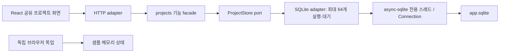

# 아키텍처와 모듈 책임

## 제품 실행 경계

제품은 인증·계정·개인 소유권 필터 없이 같은 프로젝트 디렉터리를 공유한다. 프로젝트 생성·목록·검색·일정 필터·이름 변경·보관/복원·논리 삭제는 서버의 영속 상태를 사용한다. 목업은 별도 샘플 환경이며 제품 DB에 접근하지 않는다.

## 현재 Backend 구조

| 소스                                                                            | 현재 책임                                                      |
| ------------------------------------------------------------------------------- | -------------------------------------------------------------- |
| [main.rs](../backend/src/main.rs)                                               | Tokio 진입과 app 실행                                          |
| [app/mod.rs](../backend/src/app/mod.rs)                                         | 설정·스토리지·DB·HTTP 조립과 종료                              |
| [app/config.rs](../backend/src/app/config.rs)                                   | CLI·환경변수와 절대 경로 검증                                  |
| [modules/projects](../backend/src/modules/projects/)                            | 이름·검색 범위 규칙, 공유 프로젝트 use case와 persistence port |
| [adapters/http](../backend/src/adapters/http/)                                  | JSON DTO·오류·프로젝트 라우트·Health·정적 UI                   |
| [adapters/sqlite/mod.rs](../backend/src/adapters/sqlite/mod.rs)                 | 전용 스레드, admission 제한, 작업 전달·종료                    |
| [adapters/sqlite/projects.rs](../backend/src/adapters/sqlite/projects.rs)       | 목록·조회·생성·조건부 이름 변경 SQL                            |
| [adapters/sqlite/migrations.rs](../backend/src/adapters/sqlite/migrations.rs)   | 읽기 전용 사전 검사, 백업, refinery Migration                  |
| [adapters/filesystem/storage.rs](../backend/src/adapters/filesystem/storage.rs) | 경로·폴더 검증, 잠금, 쓰기·동기화·rename·삭제 시험             |
| [V1__projects.sql](../backend/migrations/V1__projects.sql)                      | 실제 프로젝트·생성 요청 키 스키마                              |

외부 공개 경계는 `app::Application`과 실행 진입점이다. 기능과 adapter 구현은 private이며 domain은 Axum·rusqlite를 참조하지 않는다. 아직 소비자가 없는 기존 domain/database/workflow 등의 선언 파일은 제품 모듈로 연결하지 않는다. 문서 처리·목차 구성은 기능별 영속 작업으로 구현하며 범용 Workflow DAG는 별도 구현 범위다. 모델 연결과 진단은 model_registry/inference가 소유한다.

## 저장 작업과 종료

ProjectService는 좁은 `ProjectStore` 계약을 사용한다. SQLite adapter는 `async-sqlite 0.7.0` Client의 `conn_mut`로 작업을 전달하고 HTTP는 결과를 await한다. 직접 만든 스레드·채널 실행기를 유지하지 않는다. 실행·대기 합계 64개를 semaphore로 제한하며 여유가 없거나 종료 상태이면 503을 반환한다. 목록 읽기도 현재 같은 스레드에서 실행하며 별도 read pool은 아직 없다.

생성은 프로젝트와 요청 키를 한 트랜잭션에 확정한다. 이름 변경은 기준 version과 현재 version을 검사한 뒤 짧은 트랜잭션으로 갱신한다. 요청 클라이언트가 끊겨도 이미 접수한 쓰기는 완료될 수 있으므로 생성 재시도는 같은 요청 키를 사용한다.

정상 종료는 HTTP의 진행 중 요청을 끝낸 뒤 큐를 닫고 남은 작업을 처리한다. SQLite 연결을 닫은 다음 저장소 잠금을 해제하며, `Client.close().await` 완료까지 저장소 잠금을 유지한다. 종료 신호에서 업로드를 취소하고 HTTP 요청·파일 검사 작업을 종료한 뒤 DB를 닫는다.

## React 구성

[ProjectsPage](../frontend/src/pages/projects-page.tsx)는 Home의 URL 검색·페이지 상태를 맡고, [projects feature](../frontend/src/features/projects/)는 API·Query 상태·목록·생성/이름 변경 대화상자를 소유한다. [공통 HTTP](../frontend/src/shared/api/http.ts)는 Axios 인스턴스로 동일 출처 JSON 요청·timeout·취소·공개 오류 처리와 Zod 응답 검증을 담당한다. Health도 같은 transport를 사용하고 파일 전송 자체는 Uppy XHR가 맡는다.

작업 패널 표시 모드와 측정 높이는 [Zustand UI store](../frontend/src/shared/work-panel-state.ts)에 보관하며 패널과 Sonner host가 selector로 구독한다. 이 store는 탭 메모리에만 존재하고 서버 데이터나 Uppy 파일 큐를 복제하지 않는다. DOM ref·포커스·observer 정리는 컴포넌트가 소유한다.

프로젝트 서버 상태는 TanStack Query에 보관한다. 작성 중 이름·마감일과 기준 version, 재시도 키는 해당 대화상자 세션의 상태다. 일반 브라우저 저장소에 프로젝트 복제본을 만들지 않는다. 목록은 15초 간격과 포커스 복귀·수동 갱신으로 최신화하며 SSE는 아직 없다.

`/home/system`에는 연결 상태 화면을 유지한다. React Compiler는 Vite 개발·제품 빌드에 적용되고 실제 최적화 효과는 별도 측정 대상이다. [의존성 구성](08-dependencies.md)

## 목업 모듈

| 소유 모듈                                                     | 책임                                                     | 주요 협력자              |
| ------------------------------------------------------------- | -------------------------------------------------------- | ------------------------ |
| [app.js](../mock/app.js)                                      | 조립, Store·UI 상태, 라우팅, 공통 명령 연결, 페이지 종료 | 모든 기능 팩토리         |
| [data.js](../mock/js/data.js)                                 | 샘플 데이터와 프로젝트·슬라이드 초기값                   | 화면, 생성 시뮬레이션    |
| [dom.js](../mock/js/dom.js), [ui.js](../mock/js/ui.js)        | HTML 이스케이프, 공통 마크업, 슬라이드 렌더·크기 맞춤    | 화면·편집 어댑터         |
| [chrome.js](../mock/js/chrome.js)                             | 전역 메뉴, 역할 표시, 내비게이션                         | 라우팅                   |
| [studio.js](../mock/js/studio.js)                             | 입력 버전 기반 단계 확인                                 | 프로젝트, 가이드·목차    |
| [forms.js](../mock/js/forms.js)                               | 폼 입력 검증과 명령 실행                                 | 가이드·목차·대화·생성    |
| [actions-project.js](../mock/js/actions-project.js)           | 프로젝트·목차·문서 화면 명령                             | Store, 라우터            |
| [actions-presentation.js](../mock/js/actions-presentation.js) | 슬라이드 선택, 리비전 복원, 내보내기, 샘플 Admin         | 슬라이드 명령, 대화상자  |
| [space.js](../mock/js/space.js)                               | 공용 자산 메타데이터와 처리 시뮬레이션                   | 업로드 검증, 자체 타이머 |
| [asset-search.js](../mock/js/asset-search.js)                 | 샘플 검색·시각 미리보기·원본 버전 선택                   | 프로젝트와 현재 슬라이드 |
| [workflow.js](../mock/js/workflow.js)                         | 입력을 고정한 샘플 생성                                  | 샘플 슬라이드 팩토리     |
| [views/](../mock/js/views/)                                   | 화면별 구성과 조회 결과 표현                             | 기능별 상태·명령         |

편집기 모듈의 세부 책임은 [편집기 문서](03-editor.md)에 정의한다. 일부 화면·명령 팩토리는 공통 `context`를 사용하고, 선택·대화·캔버스 어댑터는 필요한 함수만 주입받는다. 전체 목업이 목표 아키텍처로 분리된 상태는 아니다.

## 변경 흐름

1. 사용자 입력을 DOM 이벤트 또는 폼 제출에서 받는다.
2. 기능 명령이 현재 프로젝트·슬라이드와 입력을 검증한다.
3. Store의 업무 상태 또는 기능이 소유한 세션 상태를 변경한다.
4. 전체 화면 재렌더 또는 해당 패널 갱신을 수행한다.
5. DOM 어댑터가 이벤트·관찰자를 연결하고 선택·포커스 상태를 반영한다.

슬라이드 편집은 [slide-commands.js](../mock/js/slide-commands.js)의 commit을 공유한다. 가이드, 목차, 공용 자산은 각 기능이 직접 소유한다. 서버 트랜잭션이나 동시 편집 제어는 이 흐름에 포함되지 않는다.

## 자원 수명

| 자원                                | 소유자                       | 해제·종료                                       |
| ----------------------------------- | ---------------------------- | ----------------------------------------------- |
| 스토리지 잠금 파일 핸들             | `Database`의 `Storage`       | 프로세스의 소유 객체 종료                       |
| 문서 미리보기 관찰자                | 문서 화면                    | 재렌더·페이지 종료 시 disconnect, fallback 취소 |
| 편집 이벤트·선택 메뉴·드래그 프레임 | 편집 어댑터                  | 재연결 전 dispose, 페이지 종료                  |
| 이미지 FileReader                   | 캔버스 어댑터                | 폐기 시 abort, 완료 시 리비전 검증              |
| 채팅 메시지·draft                   | deck별 WeakMap과 slide별 Map | 페이지 세션, 참조 해제                          |
| 샘플 생성 타이머                    | 앱의 workflow                | 완료·취소·초기화·페이지 종료                    |
| Space 처리 타이머                   | Space                        | 실행 항목 소진·초기화·페이지 종료               |
| JSON 다운로드 Object URL            | 내보내기 명령                | 다운로드 시작 후 revoke                         |

생성·Space 시뮬레이션은 단순 화면 이동 중에도 진행될 수 있다. 영속 체크포인트가 없으므로 새로고침이나 프로세스 종료 후 재개할 수 없다.

## 제품 구현으로의 연결

기능별 소유권과 포트·어댑터의 목표 구조는 [시스템 아키텍처](../blueprint/02-system-architecture.md)를 따른다. 목업의 공통 mutable context, 전체 슬라이드 복제, 배열 인덱스 기반 본문 키를 서버 도메인 계약으로 그대로 옮기지 않는다. 영속 데이터 식별자, 원자적 리비전 확정, 작업 복구 경계는 제품 구현에서 별도로 검증해야 한다.

## Home 구현 소유권

`modules/projects/dates.rs`는 서버 달력 검증을, SQLite 프로젝트 어댑터는 검색·정렬·조건부 상태 변경·논리 삭제를 담당한다. [V3 Migration](../backend/migrations/V3__project_due_date.sql)이 기존 프로젝트를 보존하며 필요한 필드와 인덱스를 추가한다.

React 프로젝트 기능은 `project-directory.tsx`의 Query/대화상자 조립, `project-filters.tsx`의 폼 draft, `project-card.tsx`의 표시, `project-menu.tsx`의 shadcn 메뉴 조합, 두 dialog의 생성·이름/수명주기 명령으로 분리한다. `calendar.ts`의 현지 날짜 타이머와 메뉴/overlay 수명은 Radix가 관리한다. 페이지/필터는 `pages/projects-page.tsx`가 URL로 관리한다. 이 중 어느 모듈도 제품의 미구현 문서·PPT 기능을 시뮬레이션하지 않는다.

Home 생성 명령은 상단 버튼이며 빈 공간 메뉴의 이벤트 소유자는 Home workspace다. 작업 패널은 body portal에 별도로 렌더링한다.

공식 shadcn 소스는 `frontend/src/components/ui/` 한 곳에서 소유한다. `due-date-picker.tsx`는 프로젝트의 날짜 문자열과 공통 Calendar/Popover의 Date props를 연결한다. `shadcn.css`는 Folio 접근성·크기 적응만 맡으며 menu/focus trap을 다시 구현하지 않는다. 공식 원본 해시·라이선스와 설치 의존성은 [컴포넌트 명세](08-dependencies.md)에 연결되어 있다.

Home route는 React lazy/Suspense로 분리되어 shadcn 메뉴·달력 코드가 독립 청크에 담긴다. 셸은 먼저 표시하고 페이지 코드를 불러오는 동안 명명된 로딩 상태를 제공한다. 실제 Query 요청과 재시도는 페이지 로딩 뒤 해당 feature가 계속 소유한다.

## Space 구현 소유권

| 소스                                                                        | 책임                                                                              |
| --------------------------------------------------------------------------- | --------------------------------------------------------------------------------- |
| [modules/assets](../backend/src/modules/assets/)                            | 파일 형식·크기, Blob 값과 저장/읽기/종료 port                                     |
| [modules/libraries](../backend/src/modules/libraries/)                      | 공용 Reference/Template의 동일한 등록·메타데이터·버전·수명주기 규칙               |
| [adapters/filesystem/blobs.rs](../backend/src/adapters/filesystem/blobs.rs) | capability 경로, 같은 파일시스템 staging, 해시·동기화·중복 제거, 업로드 admission |
| [adapters/formats](../backend/src/adapters/formats/)                        | 기존 OSS 파서로 PDF/HWP/ZIP/XML/HTML 구조 검사                                    |
| [adapters/sqlite/libraries](../backend/src/adapters/sqlite/libraries/)      | 조회, 조건부 변경, 등록/취소 receipt의 단일 쓰기 소유자                           |
| [adapters/http/space](../backend/src/adapters/http/space/)                  | multipart·DTO·상태 코드·stream 다운로드·취소 token                                |
| [features/space](../frontend/src/features/space/)                           | Uppy 전송, Query 자산, shadcn 화면·폼·버전 대화상자                               |

현재 두 라이브러리는 동일한 수명주기여서 `libraries` facade 하나를 사용하되 DB 테이블·scope는 분리한다. 분석 책임이 생길 때 Reference 검색과 Template 레이아웃 기능을 분리한다. `LibraryStore.register`는 Blob 메타데이터·파일 등록·라이브러리 버전·멱등성 결과를 한 트랜잭션에 확정하는 좁은 commit port다. 다른 코드가 이 테이블에 임의로 쓰지 않는다.

원본 바이트 검사는 최대 두 개의 파일 작업으로 제한하며 동기 파서는 Tokio blocking 경계에서 실행한다. 이는 별도 프로세스 sandbox나 영속 Workflow worker가 아니다. 긴 검사 중 DB 트랜잭션을 열지 않는다. 전송 취소와 확정 경쟁은 DB receipt로 판정하며 이미 확정된 자료를 취소 요청으로 삭제하지 않는다.

Uppy instance는 탭·라우트 이동보다 오래 유지되고 pagehide/HMR 때 정리한다. 새로고침 후 파일 전송은 이어받지 않는다. Query는 등록된 서버 자산만 보관하며 Uppy queue를 복제하지 않는다. UI는 실제 전송률과 등록 완료를 구분하고 추출 전 자료를 `분석 전`으로 표시한다.

`use-upload-engine.ts`는 Space 등록 화면과 전역 `UploadWorkPanel`이 같은 탭의 Uppy instance를 사용하게 한다. `app/feedback.tsx`는 작업 패널 높이를 받아 Sonner를 그 위에 배치한다. `shared/notifications.ts`는 모달 입력 중 새 알림을 보류하고 최대 10개만 대기시킨다. 각 feature는 공개 메시지만 전달하며 진행 상태를 토스트 저장소에 복제하지 않는다. 접기·닫기·화면 이동은 전송을 취소하지 않는다.

`adapters/formats/html.rs`는 html5ever tokenizer로 UTF-8 HTML 문서/fragment의 markup 존재와 자원 제한을 검사한다. DOM·렌더러·네트워크 실행기는 만들지 않는다. HTML 원본은 기존 Blob/Library commit 경로로 저장하고 HTTP adapter는 attachment, nosniff, sandbox CSP를 설정한다.

정상 SQLite 종료는 비동기 close를 한 번만 실행한다. 완료 후 스토리지 소유권을 해제했으면 Drop은 다시 close를 큐에 넣지 않는다. 명시적 종료가 완료되지 않은 경우에만 Drop fallback을 사용한다. 남아 있는 router handle과 반복 시작/종료를 통합 테스트로 검사한다.

## Provider 설정과 추론 경계

| 소유자                              | 책임                                                                                 |
| ----------------------------------- | ------------------------------------------------------------------------------------ |
| `modules/model_registry`            | 이름·URL·모델 ID 검증, 불변 설정 버전, 조건부 갱신, credential snapshot              |
| `modules/inference`                 | 생성 입력·schema 검사와 연결 진단 시나리오                                           |
| `adapters/llm/`                     | ProviderClient의 명시적 분기, 공통 bounded transport와 Provider별 네이티브 요청·응답 |
| `adapters/sqlite/providers.rs`      | Provider 연결·설정 버전의 단일 write owner                                           |
| `adapters/sqlite/model_requests.rs` | llm_requests의 단일 write owner                                                      |
| `adapters/filesystem/secrets.rs`    | 키 파일, XChaCha20Poly1305 envelope, 인증 복호화                                     |
| `features/providers`                | Query 목록·이력, shadcn 설정 폼·충돌 검토, 설정별 테스트 결과                        |

`app`이 이 경계를 조립하고 `/home/admin`을 공용 메뉴에 노출한다. 런타임 설정을 매 요청의 시작에 읽으므로 재시작 없이 반영하며 실행 중인 요청은 이전 snapshot을 사용한다. 호출 중 SQLite 트랜잭션을 유지하지 않는다. 서버 종료 신호는 추론 I/O를 취소하며 실행 중이던 요청 기록은 재시작 시 interrupted로 표시한다. 브라우저의 응답 대기 중단은 서버의 추론 취소를 보장하지 않는다.

이 연결 테스트는 Durable Workflow, 문서 분석, Provider fallback 또는 작업별 모델 라우팅을 구현한 것이 아니다. 네이티브 어댑터는 openai/claude/gemini/lm_studio/local_native에 나누고 호환 경로는 openai_compatible에 유지한다. 기존 `backend/src/llm/`의 미연결 scaffold를 두 번째 실행 소유자로 사용하지 않는다.

## Admin 화면 소유권

`pages/admin-page.tsx`는 Admin 메뉴, section/provider/tab URL, 메뉴 접힘과 목적지 전환 시 포커스를 소유한다. `ProviderDirectory`는 공유 연결 Query·설정 dialog만 조립하며 `ProviderPanels`가 shadcn 상세 탭을 구성한다. `ProviderChecks`는 명시적 테스트 요청과 취소, `ProviderHistory`는 이력 조회·활성 탭의 polling을 소유한다. 테스트 패널은 같은 config revision의 탭 이동 동안 mount를 유지하고 다른 config로 바뀌면 재생성한다.

`features/system-status`는 Admin과 기존 `/home/system` 페이지에서 같은 Health Query와 오류·재시도 UI를 제공한다. 메뉴를 위해 새로운 서버 API나 스토리지 복제본을 추가하지 않는다. Admin shell이 유일한 main landmark이며 하위 feature는 section으로 구성한다.

## 추론·카탈로그·시작 복구의 책임

| 소유자                                    | 책임과 경계                                                                     |
| ----------------------------------------- | ------------------------------------------------------------------------------- |
| `modules/inference/execution.rs`          | 생성 전용 schema 검증·진단 callback; 공통 실행은 model_execution에 위임         |
| `modules/inference/diagnostics.rs`        | Admin 진단 프롬프트와 기대 답변, 공통 실행 경로 호출                            |
| `modules/inference/types.rs` / `ports.rs` | 생성 입력·결과와 ModelClient 계약; 이력·오류는 model_execution 소유             |
| `modules/model_registry/kind.rs`          | ProviderKind, 직렬화 ID, 기본 주소·모델, 구현된 structured/key 정책의 단일 정의 |
| `adapters/llm/mod.rs`                     | ProviderKind의 exhaustive match로 명시적 프로토콜 분기; 문자열 fallback 없음    |
| `adapters/model_http/mod.rs`              | HTTP client·연결 timeout·응답 크기·공개 오류 처리, Provider와 인증 규칙을 모름  |
| Provider별 어댑터 / `authentication.rs`   | 네이티브 헤더·API 버전, 선택된 Bearer 헤더 조립                                 |
| `adapters/llm/response.rs`                | 네이티브 파서들이 재사용하는 응답 필드 판독                                     |

일반 실행은 진단용 정답에 의존하지 않는다. 진단 시나리오는 입력과 결과 검사만 제공하며, 공통 실행은 임의의 업무 입력에 대한 결과·schema·실패 이력을 관리한다. 이 경로를 만들었다고 문서 처리 Workflow가 구현된 것은 아니다. 어댑터에 전달하는 Credentials에는 설정 ID·종류·endpoint·모델·timeout·복호화 토큰만 포함하며, 저장용 암호문이나 전체 Provider 레코드는 전달하지 않는다.

Admin은 `GET /api/v1/admin/llm/provider-types` 카탈로그를 Query로 조회한다. 프론트의 provider-types.ts는 응답 schema만 선언하며 Provider 목록·기본값·지원 여부를 복제하지 않는다. 로딩·실패 중에는 새 연결 입력을 차단하고 다시 시도를 제공한다. 설정 폼과 상세 패널은 같은 조회 결과를 명시적인 props로 받는다.

Database.open은 연결·Migration·PRAGMA·writer 수명만 초기화한다. app이 키 검증 후 recover_uploads·recover_requests·recover_documents를 호출하며, 실제 상태 변경 SQL은 각각 SQLite library upload owner와 model request owner에만 있다. receiving→failed, running→interrupted만 적용하며 완료·취소·실패 기록은 바꾸지 않는다. 이전 원본·암호문·리비전·API 계약과 이력은 V8에서도 보존한다.

## 독립 Decision 실행

`modules/decisions`는 state·choice 질문 배치의 입력 한도, 답변 집합·선택지·확률 검증과 Evaluator port를 소유한다. LLM의 CompletionInput이나 HTTP 형식에 의존하지 않는다. `adapters/decisions/llm.rs`가 생성 ModelClient를 사용하는 bridge이며, `native.rs`는 System One·OpenAI Decisions·Gemini Decisions를 각각 변환한다. native 판정은 LLM generation adapter를 통과하지 않는다.

`modules/model_execution`은 두 서비스가 공유하는 연결별 동시 처리·유한 대기열, Registry snapshot, 응답 timeout, 종료 취소와 RequestStore를 소유한다. HTTP mechanics는 `adapters/model_http`에 있으며 인증 헤더는 프로토콜이 명시적으로 선택한다. 역사적 테이블명 llm_requests는 유지하며 SQLite request adapter가 유일한 write owner다. decision kind를 추가해 판정과 텍스트 진단을 구분한다. 입력 문서·질문·답변 본문은 요청 이력에 저장하지 않는다.

Admin의 모델 종류는 LLM/System One이다. 선택한 protocol kind에서 category를 유도하므로 별도의 중복 category 컬럼이 없다. `ConnectionType`은 서버 카탈로그 선택, `DecisionChecks`는 샘플 draft·검증·명시 실행·대기 취소를 소유한다. 네이티브 API 구현과 해당 실서버/계정의 접근 가능성은 별개다. 문서 처리 소비자는 아래 영속 파이프라인을 사용한다. 다른 기능의 모델 라우팅은 아직 없다.

## Space 처리의 책임과 실행

| 소유자                                | 책임                                                                                      |
| ------------------------------------- | ----------------------------------------------------------------------------------------- |
| modules/documents                     | 레퍼런스 추출·블록·판정 결과와 Space 처리 작업의 use case/ports                           |
| modules/documents/worker.rs           | 목적별 파이프라인 조립: 템플릿 전용 분기 또는 레퍼런스 추출→Decision 배치                 |
| modules/templates                     | PPT Master native manifest·원본 관계·재사용 번들·장표 PNG 미리보기; 내용 분류를 하지 않음 |
| adapters/sqlite/documents             | 작업·명령 receipt·lease·체크포인트·페이지/블록/판정·설정의 쓰기 소유자                    |
| adapters/sqlite/templates             | template_extractions 및 번들 Blob 등록의 조건부 commit port                               |
| adapters/processes                    | 검증된 런타임, 소유한 작업 디렉터리, 자식 프로세스 timeout·취소·결과 검증                 |
| adapters/filesystem/derived.rs        | 생성 PNG/ZIP의 동일 파일시스템 원자적 Blob 게시                                           |
| frontend/features/document-processing | 실제 상태·내용/페이지·템플릿 구조·이력·명시적 명령·Admin 기본 판정 연결                   |

Apalis core 1.2.0의 CustomBackend가 기존 SQLite 저장소에서 lease를 획득한다. 별도 SQLx/SQLite 드라이버나 이중 in-memory 큐를 만들지 않는다. 고정 Worker 2개를 각각 소유한 Tokio 런타임에서 구동하고 종료 시 취소 후 join한다. Worker thread 수는 제한돼 있으며 실제 문서 엔진은 별도 프로세스다. 현재는 고정된 영속 파이프라인이며 범용 DAG 편집기·정의 실행 엔진을 구현했다고 주장하지 않는다.

새 library version의 INSERT trigger가 최초 작업을 같은 트랜잭션으로 생성한다. 논리 삭제 trigger는 진행 중 작업을 함께 취소한다. 이는 문서 소유 migration에 정의한 원자적 교차 기능 commit 경계다. 작업 claim과 heartbeat·결과 commit은 짧은 트랜잭션이며 추출/LLM 호출은 트랜잭션 밖에 있다. 취소·lease 교체·기한 만료·자료 삭제 후 도착한 결과는 commit할 수 없다.

추출 정본은 document_extractions→document_pages→content_blocks에 한 번 저장한다. PNG는 공통 Blob Store를 참조하고 FTS5는 파생 검색 인덱스다. 판정은 원문 복사 없이 job/block/request/config를 연결한다. template_extractions는 PPT Master의 유연한 manifest/native structure와 번들 Blob 참조를 소유한다. template_previews는 순서·크기와 PNG Blob을 원본 버전의 extraction에 연결한다. 템플릿 결과는 원본 PPTX를 다시 써서 변경하지 않는다.

App::open은 저장소·복구·서비스를 조립하고 App::start_processing이 Worker를 시작한다. 실제 서버 run은 이를 자동 호출한다. 테스트는 파일 관리만 검증하는 경우 Worker를 시작하지 않고, 파이프라인 검증에서 명시적으로 시작한다. 모든 fixture 데이터는 tests/.artifacts 아래의 격리된 저장소에 있다.

## 연결별 요청 처리 설정

`modules/model_execution/capacity.rs`는 범위 검증과 기본값, `admission.rs`는 연결 UUID별 FIFO 대기·활성 요청 예약을 소유한다. Tokio oneshot과 짧은 Mutex 구간을 사용하며 I/O를 잠금 안에서 실행하지 않는다. 호출 완료·취소·future drop은 같은 예약을 반납하고, 허가 직후 아직 재개되지 않은 요청을 취소하는 경우에도 자리가 누수되지 않는다.

`adapters/sqlite/model_capacity.rs`가 `model_request_capacity`의 유일한 쓰기 소유자다. 모델 연결의 불변 설정과 별도 버전으로 저장하며 실행 전에 최신 처리 설정을 읽는다. 값은 연결 단위로 적용되므로 모델 설정 버전이 바뀌어도 별도 동시성 풀이 생기지 않는다. 모델 목록 조회·일반 추론·LLM bridge·native System One 호출이 같은 연결의 한도를 공유한다.

동시 처리 수 축소는 이미 실행 중인 요청을 중단하지 않고 새 시작을 제한한다. 대기열 축소도 수락한 요청을 버리지 않으며 새 요청만 제한한다. 증가는 대기 요청을 즉시 진행할 수 있게 한다. 대기 시간은 대기 진입 시 고정하고 실제 응답 timeout과 분리한다. 모델 자격 정보는 대기 전에 고정하므로 대기 중 모델 변경이 요청의 목적지를 바꾸지 않는다.

이 대기열은 프로세스 메모리에 있으며 문서 작업의 영속 큐와 다르다. 재시작 후 직접 API 요청은 호출자가 다시 시도하고, 문서 작업은 기존 영속 체크포인트에서 복구한다. 문서 worker 개수·SQLite 큐·외부 추론 엔진의 병렬 세션은 이 설정의 대상이 아니다.

저장 전 모델 탐색은 `model_registry::discovery_credentials`가 임시 주소·키와 기존 버전을 검증하고, `model_execution::discover`가 동시성·시간 제한을 적용한다. inference/decisions의 기존 모델 조회 port와 Provider별 adapter를 재사용하며 HTTP 계층은 DTO만 변환한다. LM Studio inventory adapter는 두 feature가 공유하되 generation과 System One 실행 경로는 유지한다. 프론트엔드는 ProviderForm이 저장 draft를, useModelDiscovery가 입력에 종속된 취소 가능한 조회 결과를 소유한다.

재사용 자료의 쓰기 소유자는 documents다. `document_materials`는 canonical content block 또는 native source locator를 연결하고 `document_native_packages`는 파생 패키지 Blob을 연결한다. 템플릿 feature의 테이블을 레퍼런스 처리에서 쓰지 않는다. `modules/ppt_imports`는 두 기능이 공유하는 원본/프로필별 불변 결과와 읽기 계약을 소유한다. `adapters/processes/pptx.rs`는 PPT Master 실행·미리보기·개별 Blob 게시와 캐시 복원을 수행하고, `adapters/sqlite/ppt_imports.rs`가 공통 결과와 구성 파일 연결의 유일한 쓰기 소유자다. 템플릿은 새 `template_import_links`를 쓰며 기존 template_extractions는 호환 조회만 한다. 추출 결과와 자료 인덱스는 동일 lease 검사와 SQLite 트랜잭션으로 확정한다. React ReferenceMaterials는 현재 job의 Query와 선택 순서만 소유한다.

`assets/packages.rs`는 정렬된 구성 파일의 경로·해시·크기 계약을 소유한다. filesystem/packages는 소유 관계 검사가 끝난 패키지만 제한된 임시 ZIP으로 만든다. 앱 조립부가 같은 Imports 인스턴스를 처리 어댑터와 템플릿 서비스에 주입한다. 전체 DB나 앱 상태를 기능에 주입하지 않는다.

Blob 정리는 `sqlite/collection.rs`가 시작 시 참조·백업·유예기간을 검사하고 `filesystem/collection.rs`의 제한된 파일 작업을 호출한다. 서비스가 열린 뒤에는 실행하지 않으므로 업로드·파생 파일 게시·DB 등록 사이의 경쟁을 만들지 않는다. 백업과 경로가 불명확하면 삭제하지 않는다. 구체적인 보존 범위는 [데이터와 HTTP 계약](04-data-api.md#공통-ppt-패키지와-저장-수명)을 따른다.

## Studio 원본과 작성 방향 소유권

등록·버전·업로드 receipt의 공통 수명주기는 `modules/libraries`가 소유한다. `Kind::Source(project_id)`는 공용 Reference/Template과 다른 `source_items/source_versions`에 저장하며 조회·교체·삭제·다운로드의 프로젝트 범위를 검사한다. 공용 Space 전체 검색에는 원본이 포함되지 않는다. HTTP의 `space/sources.rs`는 프로젝트 파일 URL을 같은 업로드/파일 처리 어댑터에 바인딩하고 `metadata.rs`가 버전·파일 응답을 소유한다. 프로젝트 삭제는 진행 중 원본 작업을 취소하고 자료를 논리 삭제한다.

`modules/documents`는 동일한 영속 큐에서 source_version을 처리하며 기존 Kordoc·PPT import·분류·체크포인트·재시도 코드를 재사용한다. 원본/프로필이 같으면 프로젝트와 Space가 추출 정본을 공유하지만 파일 등록과 실행 이력은 별개다. `modules/studio`는 현재 원본 집합의 확인과 불변 review 링크, `modules/guides`는 Do/Don’t 리비전 저장을 소유한다. 확인·가이드 저장은 새 문서 추출이나 생성 작업을 실행하지 않는다.

프론트 `features/studio`는 URL의 projectId와 단계, 파일 Query, 확인 mutation, 작성 방향 draft를 소유한다. `features/space/index.ts`의 공개 업로드·버전 보기 기능과 `features/document-processing`의 공개 미리보기를 재사용한다. Uppy 엔진은 앱 수명과 탭에 귀속되어 경로 이동 뒤에도 진행되며 저장 완료 시 Studio와 Space Query를 무효화한다. 파일 콘텐츠·업로드 큐를 별도 Zustand 상태로 복제하지 않는다.

## 관계 기반 과거 문서 검색

`modules/relations`가 검색 입력, 관계 판정 규칙, 재사용 키, 영속 검색 수명과 참고 자료 선택을 소유한다. `adapters/sqlite/relations`는 context, retrieval, lifecycle, queries, settings, selections로 책임을 나누며 관계 테이블의 유일한 쓰기 소유자다. 원본 등록·추출·가이드·Provider의 정본은 기존 소유자를 유지하고 관계 기능은 정본을 읽거나 ID로 연결한다. `http::WorkspaceApi`는 Studio·가이드·관계·통합 검색 라우터를 조립하는 작은 구성 값이며 기능에 전체 앱 상태나 DB 연결을 주입하지 않는다.

검색 생성 트랜잭션에서 현재 원본 버전·추출 ID, 가이드 리비전, 후보와 출처를 고정한다. 모델 연결이 지정되어 있으면 설정 버전도 고정하고, 미지정이면 설정 대기 상태로 둔다. 실제 모델 호출은 SQLite 트랜잭션 밖에서 수행한다. 한 검색 Worker가 영속 큐를 처리하여 동일 캐시 키에 대한 중복 병행 판정을 막는다. 그 검색 안의 요청은 최대 4개까지 병렬 실행하고 연결의 현재 max_parallel 및 공통 admission/queue 제한을 함께 적용한다.

Decisions는 고정된 Provider 종류에 따라 호출 구성을 제공한다. 네이티브 Decision은 후보 한 건과 현재 작업의 문맥만 요청에 포함하여 다른 후보 본문을 반복 전달하지 않는다. 구조화 LLM은 최대 8개 질문을 28 KiB 예산 안에서 묶는다. 각 후보에는 0~5 중 주된 관계 하나를 묻고 전체 답변의 ID·선택지·통계를 검증한 뒤 저장한다. 연결별 비밀 정보, 취소·timeout·동시성·요청 기록은 기존 model_execution이 소유한다.

React의 `features/related-documents`는 조회 조건 draft, URL의 검색 실행 ID, Query 결과, 버전 조건부 선택과 미리보기 세션을 소유한다. 기존 프로젝트/문서 처리 공개 facade를 사용하며 과거 버전 미리보기에는 정확한 job ID와 페이지 ID를 전달한다. 검색 결과를 선택해도 원본을 복사하거나 PPT 생성을 실행하지 않는다.

## Markdown 처리 책임

`adapters/markdown`이 Comrak 기반 입력 검증과 AST→문서 블록 변환을 소유한다. `formats`는 업로드 검증에, `processes/documents`는 문서 추출에 이 어댑터를 호출한다. HTML renderer나 Node subprocess를 추가하지 않는다. `documents::ExtractionProfiles`는 일반 도구 profile과 Markdown profile을 명시적으로 전달하고 SQLite 작업 어댑터가 등록 형식에 맞춰 시작 시 고정한다.

SQLite의 `registered_file_facts`는 불변 파일명에서 HTML/Markdown 해석을 결정하는 단일 조회 규칙이다. 라이브러리 목록·다운로드, 추출 작업, 관계 검색 필터가 이를 공유하며 Blob의 최초 등록 형식에 후속 문서 해석이 종속되지 않는다. 원본 바이트나 원문 텍스트의 추가 복사본은 만들지 않는다.

## Space 통합 검색 책임

`modules/search`는 Space 전용 조회 조건과 결과 계약, `adapters/sqlite/search`는 레퍼런스/템플릿의 현재 등록·기존 FTS5 블록·원본 미리보기 조회를 소유한다. 프로젝트 원본은 SQL 후보 집합에 포함하지 않는다. 읽기 전용으로 추가 색인·Blob·LLM 작업을 생성하지 않는다. 기존 `relations`는 Studio의 명시적 의미 비교 작업을 계속 소유한다.

프론트 `features/search`는 상단 검색 진입, URL 조건·페이지네이션, 뉴스형 결과 행을 소유한다. `pages/document-page`가 Space 메타데이터와 `document-processing::ProcessingView`를 조합한다. 기존 ProcessingDialog는 동일 내용을 감싸는 빠른 미리보기 frame이며, 검색 결과 상세는 모달을 사용하지 않는다. 일치 구절 표시는 두 실제 소비자를 위해 `shared/ui/match-text`로 공통화했다.

## 목차·콘텐츠 작성 책임

`modules/outlines`는 두 단계 목차, 원문 연결, 명시적 확정, 입력 버전 및 생성 작업 정책을 소유한다. `validation`은 계층·개수·중복 관계 규칙, `model`은 제한된 문맥·JSON 계약·제공한 ID 검증, `worker`는 실행 수명·취소·체크포인트 진행을 맡는다. `adapters/sqlite/outlines`는 context, queries, revisions, admission, jobs, plans로 읽기·쓰기 책임을 나누며 관련 테이블의 유일한 쓰기 소유자다.

`source_snapshot`은 Studio와 목차 기능이 함께 사용하는 읽기 전용 원본 확인 규칙이다. 기존 hash 계산 순서와 확인 기록을 유지한다. 원문·파일·가이드·모델 설정은 해당 소유자의 정본을 참조하며, 별도의 문서 본문 사본을 만들지 않는다.

`Inference::pinned_json`은 기존 model_execution의 설정 고정·동시성·대기열·취소·요청 이력을 재사용한다. 네이티브 구조화 출력을 지원하면 해당 옵션을 보내고, LM Studio Native처럼 옵션이 없는 연결은 같은 네이티브 채팅 API에 JSON 지시를 전달한 뒤 서버에서 검증한다. 호환 API나 다른 모델로 자동 전환하지 않는다. 서버 검증과 목차 도메인 검증을 통과한 응답만 체크포인트와 리비전으로 반영한다.

프론트 `features/outlines`는 조회/버전 선택, 편집 세션, 목차 행, 모델 실행, 내용 연결을 분리한다. 서버 상태는 Query, 확정 전 변경은 버전이 고정된 로컬 세션에 둔다. Studio 단계 이동 동안 세션을 유지하고 숨긴 목차 조회의 주기적 갱신을 끈다. 새로운 서버 버전이 도착해도 편집 중인 입력을 덮어쓰지 않는다.

## 근거를 확장하는 관계 검색

Relations worker는 평가와 다음 단계를 반복하고 exploration은 선택적 LLM의 추가 검색어를 검증한다. SQLite exploration은 단계·종료 조건, reads는 원문 읽기 범위와 비교 자료, pull은 FTS 후보 추가와 출처 연결을 담당한다. Inference와 Decisions는 기존 model_execution의 설정 버전·대기열·취소·요청 이력을 공유한다.

[DR-DCI](https://arxiv.org/html/2606.14885v1)의 작업 공간 확장·문서 간 검토 아이디어를 제한된 Rust 도구로 적용한다. Python/Pi 실행 환경이나 임의 셸·SQL 권한은 추가하지 않는다. 기존 단일 평가 실행은 그대로 재개하고 새 실행만 V18의 정의 버전 2 작업 공간을 사용한다. 일반 Space 통합 검색은 모델 없는 별도 조회이며 범위를 확장하지 않는다.

## 발표자료 생성 책임

`modules/presentations`가 근거 확인·디자인 선택·슬라이드 스키마·생성 정책·작업 수명을 소유한다. `adapters/sqlite/presentations`는 preparation, admission, jobs, plans, citations, publish, queries로 구분한다. 다른 기능의 원본·목차·모델 테이블은 canonical 조회만 하며 쓰지 않는다. `presentation_*` 테이블의 단일 쓰기 소유자는 이 어댑터다.

기존 inference의 고정 설정·공통 동시성·취소·요청 이력을 사용하고, 프로세스 어댑터는 PPT Master/python-pptx/Kordoc을 실행한다. Python/Node helper는 `backend/tools/`에 있으며 빌드 시 runtime으로 복사된다. 생성 Worker는 한 번에 하나의 생성 작업을 처리하며 문서 Worker와 별개다. 범용 DAG 엔진을 구현했다고 간주하지 않는다.

React `features/presentations`는 API, 근거 확인, 템플릿 선택, 생성 요청, 장표/근거 읽기로 책임을 나눈다. Studio가 기존 목차·근거 기능과 합성한다. Query가 준비 상태·작업·장표를 소유하고 로컬 훅은 제목·추가 요청·선택한 장표·요청 receipt만 보관한다. 결과물에 숨겨진 개발용 식별자를 직접 입력하도록 요구하지 않는다.

## Admin 접근 경계

Application이 프로세스 수명의 AdminAccess를 생성하고 HTTP 조립 계층의 최외곽 guard가 전체 Admin namespace를 보호한다. 검증에는 SHA-256 verifier와 subtle의 constant-time 비교를 사용한다. 서버가 생성한 고엔트로피 토큰이므로 사용자가 정하는 암호 DB나 계정 모델은 없다. 별도 Migration도 없다.

React AdminGate는 인증 전 자식 Admin 화면을 마운트하지 않는다. 검증 요청은 취소할 수 있고 토큰은 공통 전송 경계의 메모리에만 존재한다. 잠금/이탈 시 보호된 Query 및 admin 메타데이터를 가진 mutation 캐시를 제거한다. Studio는 별도의 공개 authoring DTO와 캐시 키를 사용한다. 입력창은 shadcn Input/Button/Label과 네이티브 password·current-password·required 의미를 유지한다.

Studio의 고정 진행 표시 높이는 `use-studio-chrome.ts`가 실제 전역 메뉴와 Stepper를 관찰해 소유한다. 페이지 스크롤 여백과 근거/장표 작업 영역은 같은 높이를 사용하고, Studio를 떠나면 관찰자와 CSS 예약값을 해제한다. 생성 화면은 `generation.tsx`의 이력·작업 명령, `generation-form.tsx`의 초안·멱등 생성 요청, `deck-preview.tsx`의 패널·슬라이드·확대 상태, `deck-inspector.tsx`의 현재 장표 읽기로 나뉜다. 펼침/접힘은 서버 데이터를 수정하지 않는다.

대화 수정은 같은 presentations 소유자 안에서 `edits.rs`(실행), `edit_model.rs`(허용된 수정 명령/검증), SQLite `edits/{admission,lifecycle,apply}.rs`(영속 경계)로 나뉜다. Worker는 수정 요청 한 개와 생성 작업 한 개를 순차 처리하며 외부 모델 admission은 기존 model_execution을 사용한다. React `slide-chat.tsx`가 서버 메시지/명령을 연결하고 `chat-drafts.ts`가 제한된 메모리 draft, `edit-proposal.tsx`가 전후 비교와 명시적 적용을 맡는다. 자세한 범위는 [편집기](03-editor.md)와 [V20 계약](04-data-api.md#v20-슬라이드-대화-수정)을 따른다.
